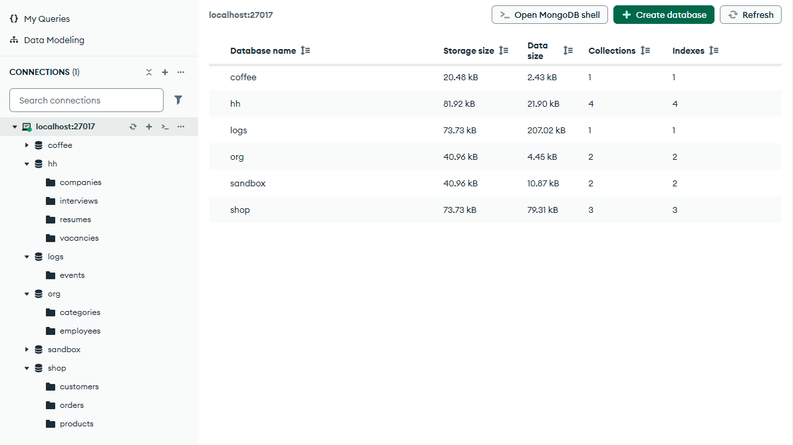
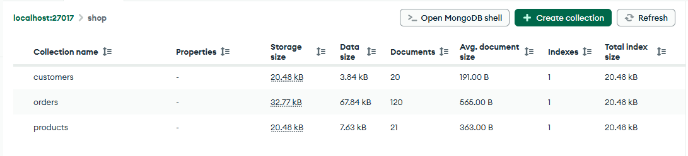
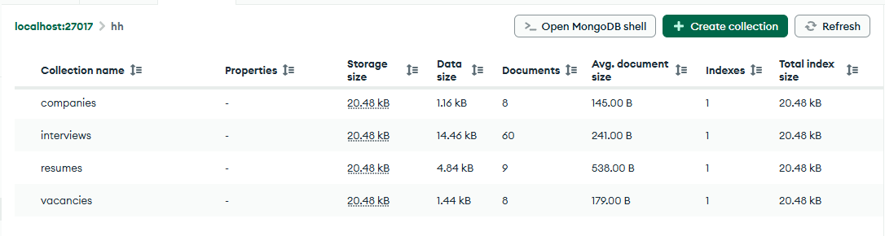
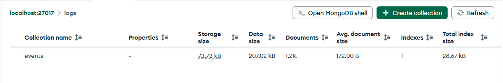
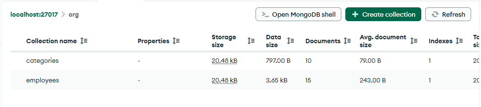

# Домашнее задание № 2 · модуль 1 справочника и базы курса

Срок — до начала занятия 3.

## Задание

1. Пройти модуль 1 справочника, главы 1.1–1.8.
2. Поднять стенд курса и убедиться, что развернулись четыре базы.
3. Приложить скриншоты Compass и заполнить таблицу с числами.

## Как поднимал стенд

Docker на машине не установлен, поэтому использован второй способ из
[`stend/SETUP.md`](../stend/SETUP.md): локальный сервер MongoDB Community 9.0.4,
запущенный на `127.0.0.1:27017`. Данные курса залиты из папки `stend/seed`
репозитория `mongodb-practice` скриптом загрузки, коллекции пересозданы
с нуля (`--drop`), поэтому числа совпадают с эталонными.

- Сервер: MongoDB 9.0.4, `mongod --dbpath ... --port 27017 --bind_ip 127.0.0.1`
- Клиент: MongoDB Compass, подключение `mongodb://localhost:27017`
- Источник данных: `mongodb-practice/stend/seed`

## Сколько документов должно быть

Данные у всех одинаковые, поэтому числа должны совпасть.

| База | Должно быть | У меня |
|---|---|---|
| `shop` | products 21 · orders 120 · customers 20 | products 21 · orders 120 · customers 20 |
| `hh` | resumes 9 · vacancies 8 · companies 8 · interviews 60 | resumes 9 · vacancies 8 · companies 8 · interviews 60 |
| `logs` | events 1200 | events 1200 |
| `org` | employees 15 · categories 10 | employees 15 · categories 10 |

Все восемь коллекций совпали с ожидаемыми числами.

## Скриншоты

Пять кадров из Compass в папке `screens/`: список баз и каждая база с числами
документов.

```





```

## Что показать на приёмке

Открыть Compass, подключиться к `mongodb://localhost:27017`, показать любую
из четырёх баз и назвать число документов в её коллекциях.
