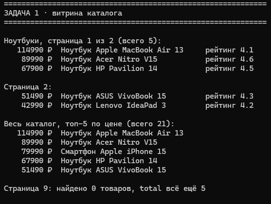
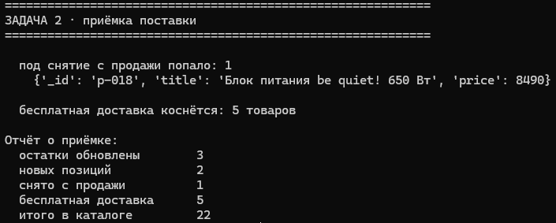
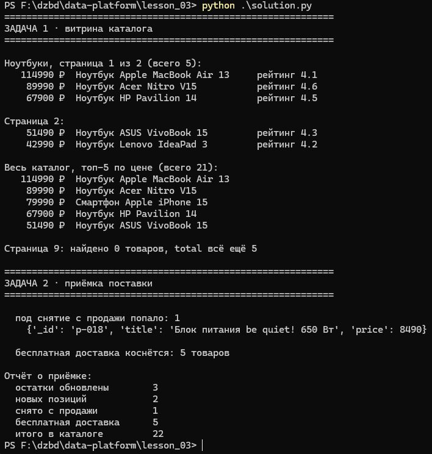
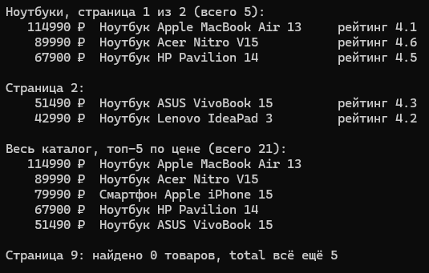
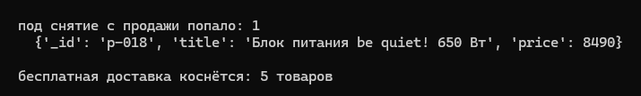
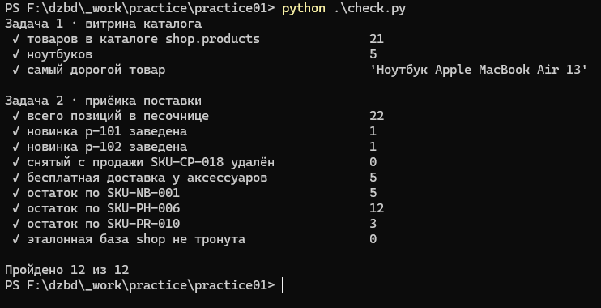

# Домашнее задание № 3 · «Каталог товаров»

Срок — до начала следующего занятия.

## Задание

Выполнена практическая работа из справочника:

<https://maximbytecamp.github.io/mongodb_theory_makarov/praktiki/01-katalog-tovarov/index.html>

Работа выполнена в своей копии `data-platform-template`. Выбран вариант запуска
**без Docker**: локальный сервер MongoDB Community 9.0.4, данные залиты из
`stend/seed` репозитория `mongodb-practice`. Решение лежит рядом —
[`solution.py`](solution.py).

## Что сделано

1. Запущен локальный сервер MongoDB на `mongodb://localhost:27017`.
2. Загружены товары практики: база `shop` (эталон, 21 товар) и её копия
   `sandbox` для изменений.
3. Выполнены операции практики: чтение каталога с проекцией и сортировкой,
   постраничный вывод, поиск по категории, приёмка поставки (остатки через
   `$inc`, две новые позиции, снятие с продажи, бесплатная доставка
   аксессуарам).
4. Результат проверен запросами к MongoDB и самопроверкой `check.py`.
5. Заполнен этот отчёт и приложены скриншоты.

## Скриншоты

Положите в `lesson_03/screens/` шесть PNG или JPG. Текст команды и результата
должен быть читаемым; на кадре должно быть понятно, какая программа запущена.

| Файл | Что должно быть видно |
|---|---|
| `01-program-start.png` | Запущенная программа каталога или успешное подключение к MongoDB; видна команда запуска или окно приложения |
| `02-products-created.png` | Результат создания/загрузки товаров: сообщение программы, список или ответ MongoDB |
| `03-catalog-result.png` | Вывод каталога после чтения документов; видны названия и основные поля товаров |
| `04-search-result.png` | Условие поиска/фильтра и найденные товары |
| `05-update-or-delete-result.png` | Результат изменения или удаления товара |
| `06-database-check.png` | Проверка в Compass или терминале: коллекция, документы, количество или ответ запроса |

## Отчёт

**ФИО:** Гущин Даниил  
**Группа:** 9/4-РПО-23/1  
**Дата:** 01.11.2026

### Среда выполнения

- ОС: Windows 11 Pro (10.0.26300)
- Язык и версия: Python 3.12.10, драйвер PyMongo 4.19.0
- MongoDB / Compass: MongoDB Community 9.0.4 / MongoDB Compass
- База данных: `shop` — чтение, `sandbox` — изменения
- Коллекция: `products`
- Команда запуска: `python solution.py`

### Результаты

Загружен каталог из 21 товара (категории «ноутбуки», «смартфоны», «принтеры»,
«аксессуары» и другие). Программа вывела страницу витрины ноутбуков: страница 1
из 2 (5 товаров всего), топ-5 каталога по цене и пустую девятую страницу —
`найдено 0 товаров, total всё ещё 5`.

При приёмке выполнены четыре операции: остатки трёх артикулов увеличены через
`$inc` (обновлено 3 позиции), добавлены две новые позиции (`p-101`, `p-102`),
снят с продажи `SKU-CP-018` (перед удалением показан найденный документ),
всем пяти аксессуарам выставлена бесплатная доставка. Итого в песочнице
стало 22 позиции. Самопроверка `check.py`: **Пройдено 12 из 12**, эталонная
база `shop` не изменена.

### Скриншоты

1. Запуск: 
2. Создание товаров: 
3. Каталог: 
4. Поиск: 
5. Изменение/удаление: 
6. Проверка в базе: 

### Ответы на вопросы

1. **Какие поля есть у документа товара?** У товара есть `_id`, `sku`, `title`,
   `brand`, `category`, `price`, `rating`, `reviews`, а после приёмки ещё
   `qty_total` и `free_shipping`. Цену и количество нельзя хранить строками:
   по ним идёт сортировка и сравнение (`$gt`, `$lt`), а строки сравниваются
   посимвольно — `"90000"` окажется больше `"114990"`. Кроме того, `$inc`
   с остатком работает только с числом; для строки он вернёт ошибку типа.

2. **Чем обычное чтение отличается от поиска по условию?** Обычное чтение
   `find({})` возвращает всю коллекцию, а поиск добавляет фильтр, и сервер
   отбирает только подходящие документы. В работе это видно на функции
   `catalog_page`: она собирает фильтр `{"category": "ноутбуки"}`, делает
   проекцию `{"_id": 0, "sku": 1, "title": 1, "price": 1, "rating": 1}`,
   сортирует по `price` и `sku` и берёт только нужную страницу через
   `skip`/`limit`. Без фильтра тот же код возвращает весь каталог.

3. **Как проверил, что данные действительно изменились?** После запуска
   программы отдельно запросил базу тем же драйвером: в `sandbox.products`
   22 документа, `qty_total` равен 5, 12 и 3 у трёх артикулов, у пяти
   аксессуаров `free_shipping: true`, а `SKU-CP-018` больше не находится.
   Эти же числа независимо проверил скрипт `check.py`, который смотрит на
   состояние базы, а не на текст программы, — 12 проверок из 12 совпали.

### Вывод

Я научился(ась) отдавать страницу каталога с фильтром, проекцией и
сортировкой по двум ключам, а также безопасно проводить приёмку поставки:
менять остатки на сервере через `$inc`, заводить позиции с собственным `_id`
против дублей и считать данные перед удалением. Программа запускается
повторно без ошибок подключения. В MongoDB проверено, что изменения легли
в `sandbox`, а эталонная база `shop` осталась нетронутой.

## Критерии оценки — 10 баллов

- 2 балла — практика выполнена полностью;
- 2 балла — программа запускается и подключается к MongoDB;
- 2 балла — результаты подтверждены скриншотами;
- 2 балла — отчёт заполнен и ссылки работают;
- 2 балла — даны содержательные ответы на три вопроса.
