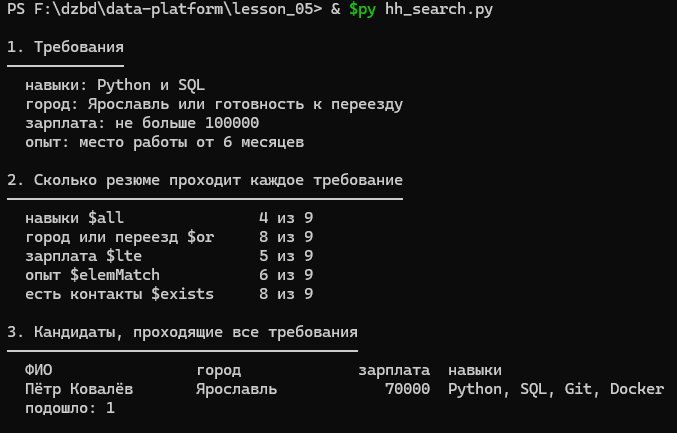
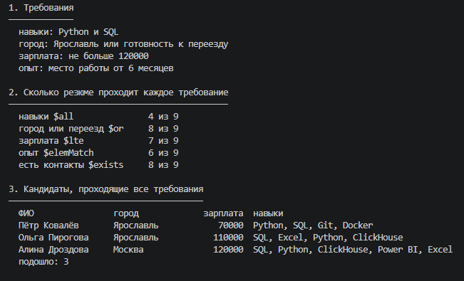
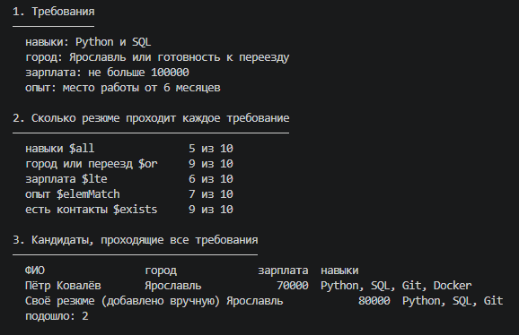

# Домашнее задание № 5 · Скрипт подбора кандидатов

Глава 2.9 справочника:

<https://maximbytecamp.github.io/mongodb_theory_makarov/temy/18-skript-podbor/index.html>

Скрипт скопирован рядом — [`hh_search.py`](hh_search.py). Язык — Python,
база `hh`, запуск на локальном сервере MongoDB 9.0.4:

```bash
python hh_search.py
```

Перед каждым запуском база возвращалась в исходное состояние (9 резюме),
затем менялась ровно одна переменная из четырёх: `NAVYKI`, `GOROD`,
`POTOLOK`, `OPYT_MESYACEV`.

## Каким оператором сделан каждый раздел

| Раздел отчёта | Оператор |
|---|---|
| 1. Требования | вывод четырёх переменных |
| 2. Каждое требование по отдельности | `$all`, `$or`, `$lte`, `$elemMatch`, `$exists` |
| 3. Все требования сразу | один фильтр с `$all`, `$lte`, `$elemMatch` и `$or` |
| 4. Должности на Junior | `$regex` с `$options: "i"` |
| 5. Подходящие вакансии | сравнение полей вложенного объекта `salary.from` / `salary.to` |
| 6. Собеседования за неделю | `$gte` / `$lt` по дате и счётчики по `stage` и `format` |
| 7. Проверка данных | `$exists`, `$type`, `$size`, `$expr`, `$ne` |
| 8. Кто не прошёл отбор | проверка условий в Python по прочитанным документам |

## Таблица

Считается раздел 3 «Кандидаты, проходящие все требования».

| Что изменено | Подошло кандидатов | Кто |
|---|---|---|
| ничего, исходные требования | 1 | Пётр Ковалёв |
| навыки: `["Python"]` (убрали SQL) | 2 | Пётр Ковалёв, Марк Ефремов |
| город: `Москва` | 0 | — |
| потолок зарплаты: `120000` | 3 | Пётр Ковалёв, Ольга Пирогова, Алина Дроздова |
| срок работы: `3` месяца | 2 | Пётр Ковалёв, Ксения Лапина |
| добавлено своё резюме | 2 | Пётр Ковалёв, Своё резюме (добавлено вручную) |

Исходные требования: навыки `Python` и `SQL`, город `Ярославль` или готовность
к переезду, зарплата не больше `100000`, опыт от `6` месяцев.

## Скриншоты

- `01-zapusk.png` — запуск с исходными требованиями: видны команда и разделы 1–3;
- `02-drugie-trebovaniya.png` — запуск с изменённым требованием: видны раздел 1 и раздел 3;
- `03-svoe-rezyume.png` — своё резюме в разделе 3 отчёта.

```



```

## Вывод

Нужно смягчить **потолок зарплаты** — поднять его со `100000` до `120000`.
При исходных требованиях раздел 3 находит одного кандидата, а при потолке
`120000` — уже трёх: Петра Ковалёва, Ольгу Пирогову (`110000`) и Алину
Дроздову (`120000`). Выше `120000` число не растёт, то есть этого значения
достаточно.

По числам разделов 2 и 8 видно, почему именно зарплата: требование
`salary $lte` проходит 5 резюме из 9, и раздел 8 показывает четверых, у кого
зарплата выше потолка. При этом Ольга и Алина не проходят **только** по
зарплате — все остальные требования у них выполнены, поэтому ослабление
одного этого условия сразу добавляет двух кандидатов. Ослабление навыков
(только `Python`) добавляет лишь Марка Ефремова: у остальных «нет навыков»
идёт вместе с другой причиной отказа. Снижение опыта до 3 месяцев добавляет
только Ксению Лапину. Поэтому единственное требование, дающее не меньше трёх
кандидатов, — зарплата, и проверка запуском это подтвердила.

После работы база возвращена в исходное состояние (9 резюме) загрузкой
`stend/seed` заново.

## Сдача

Ветка `hw-05`, Pull Request в свою `main`.
